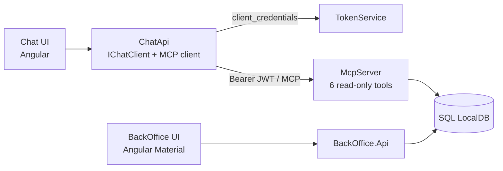

# Procesos Legales Lab

[](https://github.com/dalabe/AgentLab/actions/workflows/ci.yml)
[](https://github.com/dalabe/AgentLab/actions/workflows/codeql.yml)
[](https://github.com/dalabe/AgentLab/actions/workflows/security.yml)
[](LICENSE)

An educational, end-to-end **Model Context Protocol (MCP)** reference implementation in
**.NET 10 / C#** and **Angular 21**.

A chat UI answers natural-language questions (in Spanish) about people and their legal cases.
An LLM — Anthropic Claude, or a deterministic Mock that needs no API key — calls **read-only tools**
exposed by a **JWT-protected MCP server**, through an MCP client, using real **OAuth2 client
credentials** security between services. A BackOffice manages the data in SQL Server LocalDB.



## Features

- MCP server (`ModelContextProtocol.AspNetCore`, stateless HTTP) with 6 tools; MCP client in C#.
- `Microsoft.Extensions.AI` `IChatClient` with automatic tool invocation; swap providers by config.
- OAuth2 client credentials STS, 5-minute HS256 JWTs, scope-based authorization, rate limiting.
- Tool-call transparency: every answer shows which tools ran, with arguments and results.
- BackOffice CRUD with document upload/download protected against path traversal.
- One-F5 startup with .NET Aspire dashboard and OpenTelemetry.
- CI with build, tests, formatting, CodeQL, secret scanning, dependency audit, DAST and Scorecard.

## Quick start

Prerequisites: Windows, .NET SDK 10, Node 20+, SQL Server Express LocalDB.

```powershell
git clone https://github.com/dalabe/AgentLab.git; cd AgentLab
# 1. generate User Secrets (see docs/RUNBOOK.md §3 for the 4 commands)
# 2. start backend
dotnet run --project src/Procesos.AppHost
# 3. start frontends (two terminals)
cd src/procesos-chat-web; npm ci; npm start          # http://localhost:4200
cd src/procesos-backoffice-web; npm ci; npm start    # http://localhost:4300
```

Ask: `¿Cuál es el estado del proceso EXP-2024-00031?`

Full instructions: [docs/RUNBOOK.md](docs/RUNBOOK.md).

## Documentation

| Document | Content |
|---|---|
| [docs/ARCHITECTURE.md](docs/ARCHITECTURE.md) | C4 views, request flow, data view, quality attributes |
| [docs/SECURITY.md](docs/SECURITY.md) | Security model and STRIDE threat model |
| [docs/RUNBOOK.md](docs/RUNBOOK.md) | Setup, secrets, run, troubleshooting |
| [specs/](specs/README.md) | Requirements, MCP tool contract, HTTP APIs, data model |
| [specs/adr/](specs/adr/README.md) | Architecture Decision Records |
| [AGENTS.md](AGENTS.md) · [llms.txt](llms.txt) | Context for AI coding agents |
| [CONTRIBUTING.md](CONTRIBUTING.md) | Workflow and quality gates |
| [SECURITY.md](SECURITY.md) | Vulnerability reporting |

## Tech stack

.NET 10 · ASP.NET Core minimal APIs · EF Core 10 · .NET Aspire 13 · ModelContextProtocol 2.4 ·
Microsoft.Extensions.AI · Anthropic .NET SDK · Angular 21 · Angular Material · Vitest · xUnit.

## License

[MIT](LICENSE)
