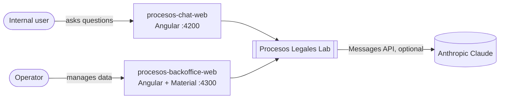
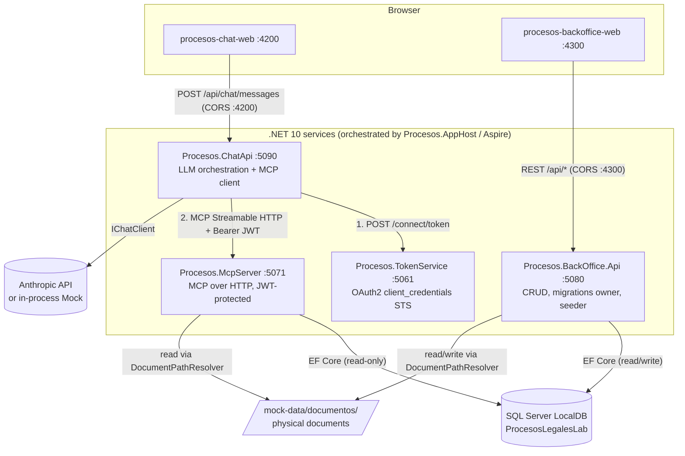
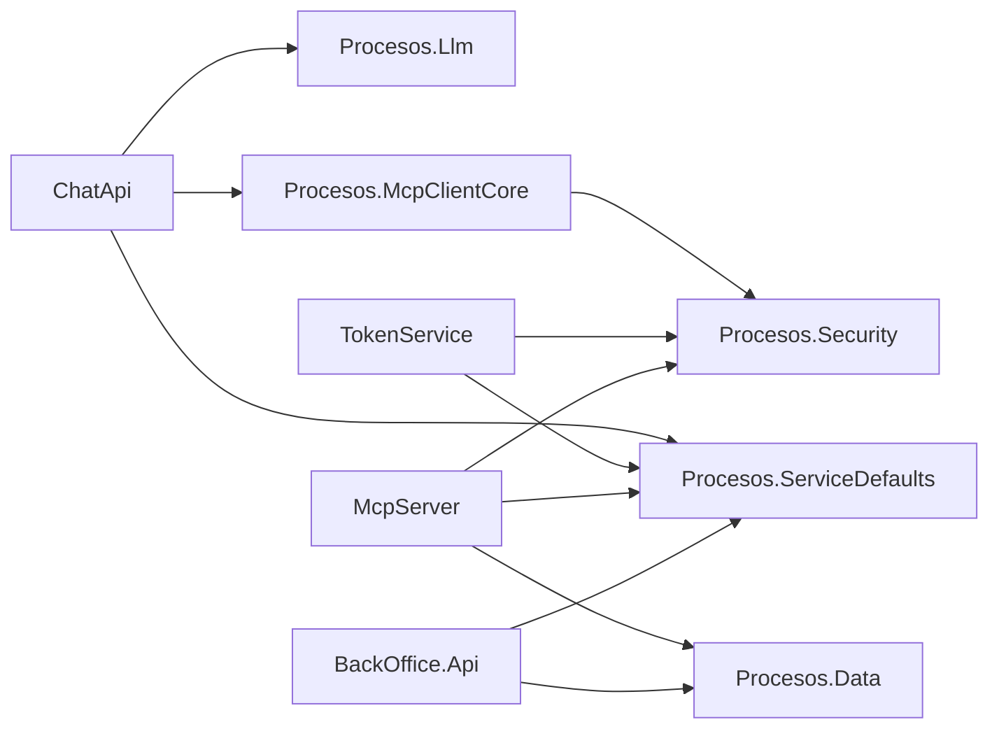
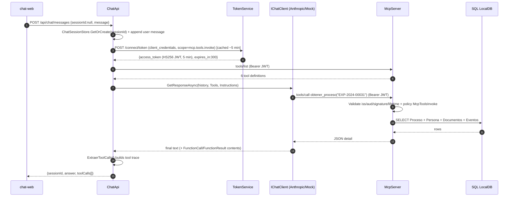
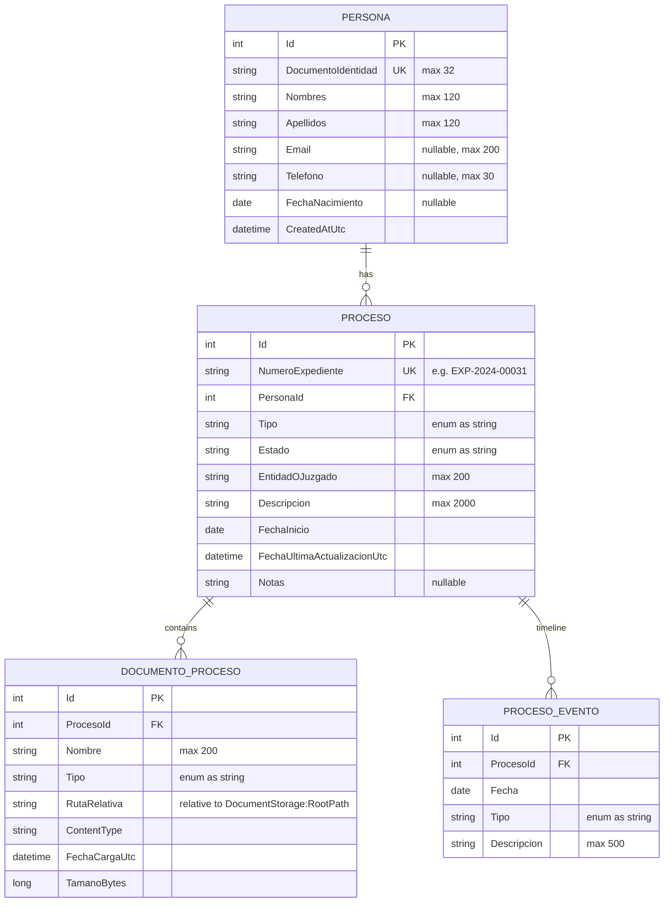

# Architecture

> Audience: engineers and AI coding agents. For the *why* behind each choice see the
> Architecture Decision Records in [`specs/adr/`](../specs/adr/README.md). For normative
> contracts (APIs, MCP tools, data model) see [`specs/`](../specs/README.md).

## 1. Context (C4 level 1)

Procesos Legales Lab is an **educational reference implementation** of the Model Context
Protocol (MCP) end to end in .NET/C#. A human asks questions in natural language (Spanish)
about people and their legal cases ("procesos" / "expedientes"); an LLM answers them by calling
read-only tools exposed by an MCP Server, through an MCP Client, with real service-to-service
security (OAuth2 client credentials + short-lived JWT). A separate BackOffice lets an operator
manage the underlying data.

There is **no end-user authentication** by design (see [ADR-0013](../specs/adr/0013-no-end-user-authentication.md)).

## 2. Containers (C4 level 2)

| Container | Tech | Port | Responsibility | Talks to |
|---|---|---|---|---|
| `procesos-chat-web` | Angular 21 (standalone, signals) | 4200 | Single-page chat UI, shows tool-call trace | ChatApi |
| `procesos-backoffice-web` | Angular 21 + Angular Material | 4300 | Admin UI for Personas, Procesos, Documentos, Eventos | BackOffice.Api |
| `Procesos.ChatApi` | ASP.NET Core minimal API | 5090 | Holds chat history, calls LLM with MCP tools, returns answer + tool trace | TokenService, McpServer, LLM |
| `Procesos.TokenService` | ASP.NET Core minimal API | 5061 | Minimal STS: `POST /connect/token` (client_credentials), rate limited | — |
| `Procesos.McpServer` | ASP.NET Core + `ModelContextProtocol.AspNetCore` | 5071 | Stateless MCP server exposing 6 read-only tools; requires JWT with `scope=mcp.tools.invoke`; **no CORS** | SQL LocalDB, filesystem |
| `Procesos.BackOffice.Api` | ASP.NET Core minimal API + EF Core | 5080 | CRUD, document upload/download, applies migrations and seeds mock data (Development) | SQL LocalDB, filesystem |
| `Procesos.AppHost` | .NET Aspire AppHost | dashboard | Starts the 4 .NET services with one F5; does **not** inject config | all .NET services |

## 3. Components (C4 level 3) — shared libraries

| Library | Key types | Notes |
|---|---|---|
| `Procesos.Data` | `ProcesosDbContext`, entities (`Persona`, `Proceso`, `DocumentoProceso`, `ProcesoEvento`), `DbSeeder`, `DocumentPathResolver`, `RepoPaths`, `ProcesosDbContextFactory` | Single source of truth for schema; enums stored as strings |
| `Procesos.Security` | `JwtOptions`, `JwtAccessTokenFactory`, `McpSecurityDefaults`, `ClientCredentialsTokenProvider` (`IServiceTokenProvider`), `AddProcesosResourceAuthentication` | Issuer, validator and client all share the same constants so claim shape cannot drift |
| `Procesos.Llm` | `AddProcesosChatClient`, `LlmOptions`, `MockChatClient` | Registers `IChatClient` wrapped with `UseFunctionInvocation()` |
| `Procesos.McpClientCore` | `IProcesosMcpClientAccessor`, `BearerTokenHandler`, `McpServerOptions` | Lazily creates one `McpClient` over `HttpClientTransport`; handler attaches the service token |
| `Procesos.ServiceDefaults` | `AddServiceDefaults`, `MapDefaultEndpoints` | Aspire template: OpenTelemetry, health checks (`/health`, `/alive` in Development), resilience, service discovery |

Dependency rule: **services depend on libraries, libraries never depend on services**, and
`Procesos.Data` / `Procesos.Security` have no dependency on each other.

## 4. Runtime view — one chat question, step by step

Example: the user types **"¿Cuál es el estado del proceso EXP-2024-00031?"**

Details per step:

1. **Angular → ChatApi**: `ChatService.sendMessage()` posts to
   `http://localhost:5090/api/chat/messages` (`procesos-chat-web/src/app/chat/chat.service.ts`).
2. **History**: `ChatSessionStore` (in-memory `ConcurrentDictionary`, keyed by `sessionId`; a new
   GUID is generated when null) — `Procesos.ChatApi/Endpoints/ChatEndpoints.cs`.
3. **Tool discovery**: `IProcesosMcpClientAccessor.GetClientAsync()` creates (once) an `McpClient`
   over `HttpClientTransport` pointed at `Mcp:Server:Endpoint`, whose `HttpClient` has a
   `BearerTokenHandler`. Tools are listed **on every request**, so new server tools appear in the
   chat without code changes.
4. **Token acquisition**: `ClientCredentialsTokenProvider` posts to `/connect/token`. TokenService
   validates the secret in constant time and issues an HS256 JWT valid for 5 minutes
   (`JwtAccessTokenFactory`). The client caches it until ~30 s before expiry.
5. **LLM call**: `IChatClient.GetResponseAsync(history, options)` with `options.Tools` = MCP tools
   (`McpClientTool` is an `AIFunction`) and `options.Instructions` = `ChatEndpoints.SystemInstructions`.
   - **Anthropic mode**: `UseFunctionInvocation()` runs the tool-calling loop automatically.
   - **Mock mode** (default in `appsettings.json`): `MockChatClient` detects an `EXP-YYYY-NNNNN`
     pattern or a person name with regex and invokes the tool directly.
6. **Tool execution**: McpServer validates the JWT and the `McpToolsInvoke` policy, then runs
   `ProcesoTools.ObtenerProceso` against `ProcesosDbContext` (`AsNoTracking`).
7. **Trace**: `ExtraerToolCalls()` pairs `FunctionCallContent`/`FunctionResultContent` by `CallId`
   and returns them for the UI's "Qué hizo" panel.
8. **UI** renders the answer and a collapsible `
` with the tool trace.

## 5. Data view

All relationships cascade on delete. Full contract: [`specs/data-model.md`](../specs/data-model.md).

Binary content is **never** stored in the database: `DocumentoProceso.RutaRelativa` points to a
file under `DocumentStorage:RootPath` (default: `<repo>/mock-data/documentos`, located at runtime
by `RepoPaths.FindRepoRoot()` searching upward for `ProcesosLegalesLab.slnx`). Every access goes
through `DocumentPathResolver.ResolveFullPath()` (path-traversal guard).

## 6. Deployment view (local lab)

Everything runs on a single Windows developer machine over plain HTTP on `localhost`.

| Process | How it starts | Config source |
|---|---|---|
| 4 .NET services | F5 on `Procesos.AppHost` **or** `dotnet run --project ...` each | Own `appsettings.json` + User Secrets |
| 2 Angular apps | `npm start` in each folder | Hardcoded URLs in `src/app/**/*.config.ts` |
| SQL LocalDB | Auto-started by SQL Server on first connection | `ConnectionStrings:ProcesosDb` |

Production hardening is **out of scope** and is listed in [`docs/SECURITY.md`](SECURITY.md#what-was-not-implemented-and-why).

## 7. Cross-cutting concerns

| Concern | Approach | Where |
|---|---|---|
| Service-to-service authN/Z | OAuth2 client credentials, HS256 JWT, scope policy | `Procesos.Security`, ADR-0004/0005 |
| Browser access control | CORS allow-list per API, none on McpServer | each `Program.cs` |
| Abuse protection | Fixed-window rate limit 30 req/min on `/connect/token` | `Procesos.TokenService/Program.cs` |
| Path traversal | `DocumentPathResolver` normalises and checks root prefix | `Procesos.Data/Storage` |
| Observability | OpenTelemetry traces/metrics/logs via ServiceDefaults; Aspire dashboard | `Procesos.ServiceDefaults` |
| Resilience | `AddStandardResilienceHandler()` on every `HttpClient` | `Procesos.ServiceDefaults` |
| Serialization | `System.Text.Json`, enums as strings, OAuth responses in snake_case | `Procesos.BackOffice.Api/Program.cs`, `TokenEndpoint.cs` |
| Secrets | `dotnet user-secrets` only; never in `appsettings*.json` | ADR-0004, `docs/RUNBOOK.md` |
| Quality gates | Build + tests + analyzers + CodeQL + secret/dependency scanning + DAST in GitHub Actions | `.github/workflows`, ADR-0015 |

## 8. Why SQL LocalDB (not an Aspire container)

The lab must expose a real local SQL database that can be managed from Visual Studio like any
other .NET project. `Procesos.AppHost` therefore does **not** declare an Aspire `AddSqlServer`
resource; each service reads the same LocalDB connection string from its own
`appsettings.json`, so every service remains runnable stand-alone with `dotnet run`. Aspire only
orchestrates **startup** (ordering, dashboard, single F5). See
[ADR-0007](../specs/adr/0007-sql-server-localdb.md) and [ADR-0008](../specs/adr/0008-aspire-orchestrates-dotnet-only.md).

## 9. Quality attributes and known limitations

| Attribute | Current state | Limitation / next step |
|---|---|---|
| Security | S2S auth with short-lived scoped tokens, CORS allow-lists, path-traversal guard | HS256 shared secret, HTTP only, no end-user auth, upload has no type/size allow-list |
| Scalability | Stateless MCP server | ChatApi history is in-process memory (lost on restart, not shared between instances) |
| Portability | .NET 10 cross-platform code | LocalDB is Windows-only; Linux CI runs build/unit tests, not DB-backed flows |
| Testability | `MockChatClient` gives deterministic answers without an API key | Integration tests cover TokenService and McpServer auth, not full DB flows |
| Evolvability | `IChatClient` and standard OAuth2 shape allow swapping LLM provider / IdP by configuration | — |
